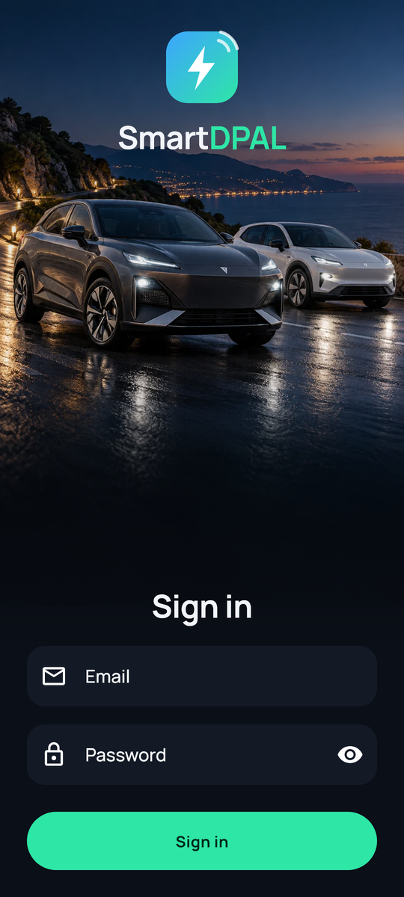
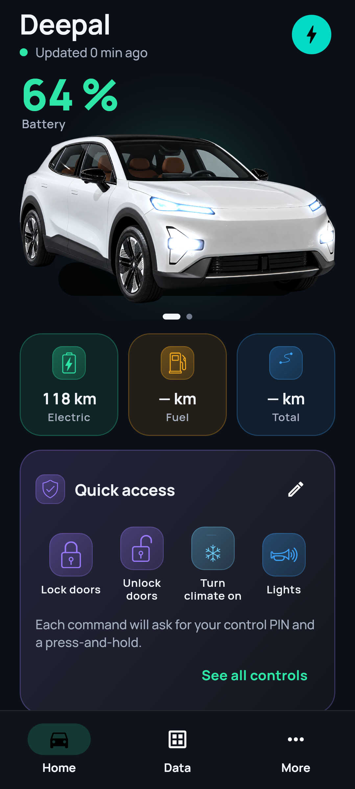
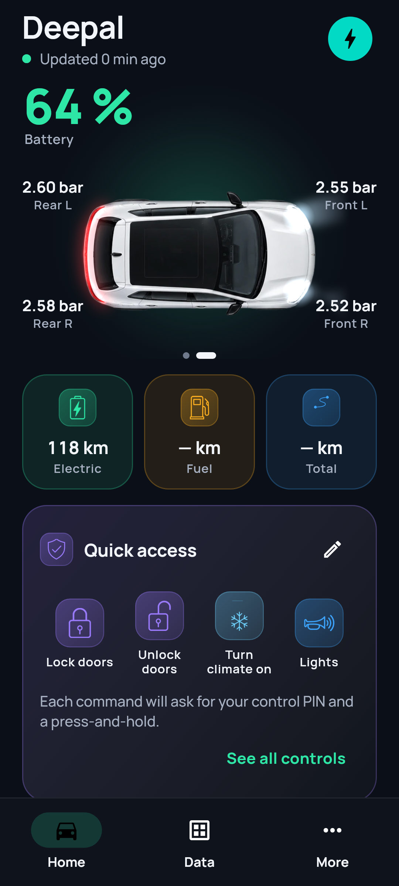
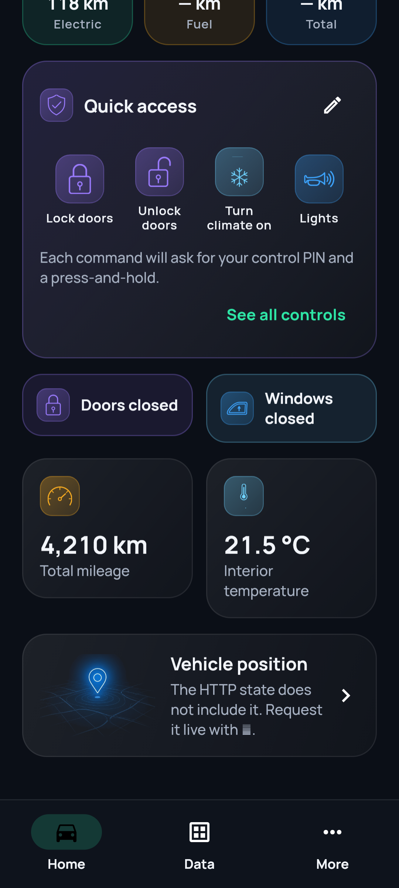
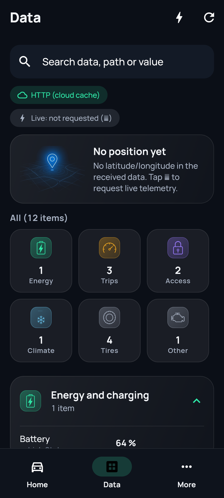
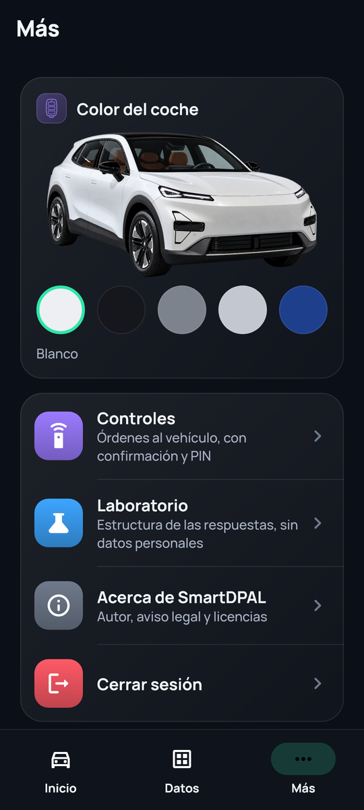
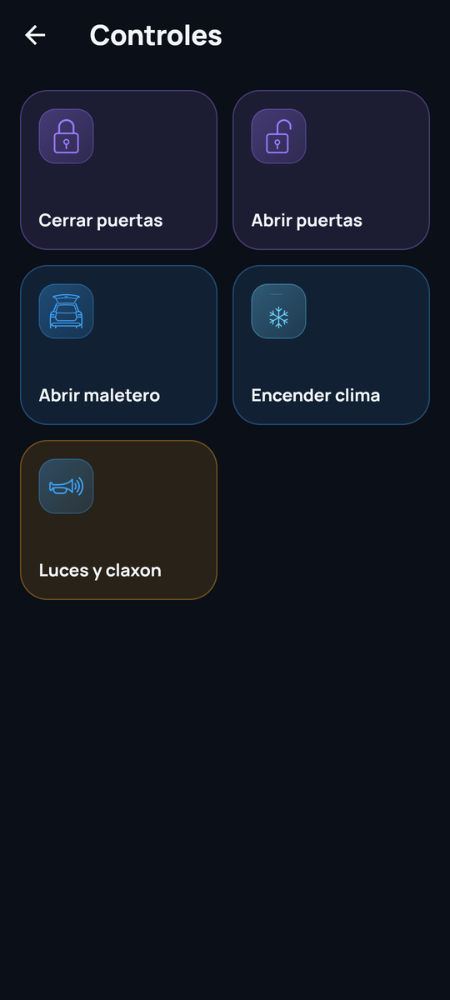
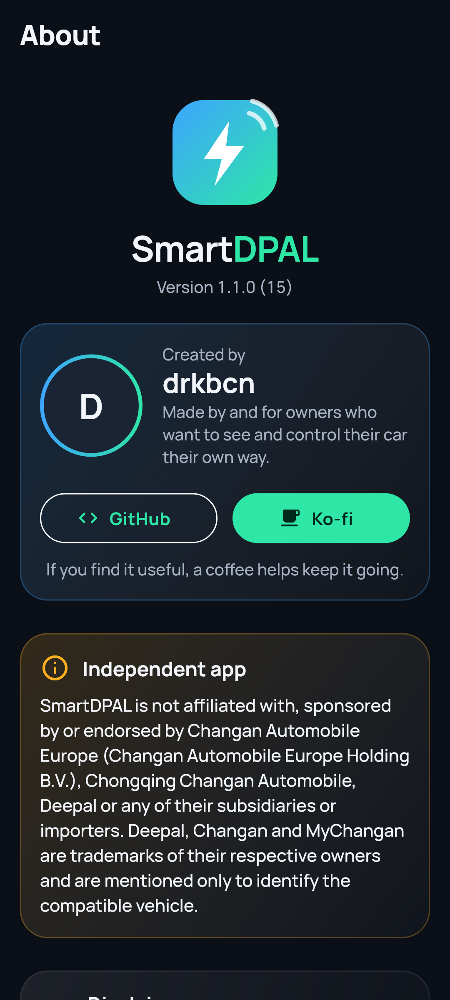

<div align="center">

# SmartDPAL

[](../../releases)
[](../../releases/latest)

**An independent, alternative Android app for your Deepal.**
See your car's state at a glance, in a clean, modern interface.

   

</div>

> **Not affiliated with Changan or Deepal.** SmartDPAL is an unofficial community project. It is not sponsored, endorsed or supported by Changan Automobile Europe, Chongqing Changan Automobile, Deepal, or any of their subsidiaries or importers. See the [disclaimer](#disclaimer).

This repository only hosts the **compiled releases**. The source code is not published.

## Download

Get the latest APK from the [**Releases**](../../releases/latest) page and install it on your Android phone (Android 7.0 or newer). You will need to allow installing apps from your browser or file manager the first time.

SmartDPAL checks this page for new versions: when one is published you get a discreet notice in the app (and a manual *Check* button under **More → About**). Updates are installed over the existing app and keep your session.

Verify the download if you like. Every APK is signed with the same certificate:

```
SHA-256: c2:f2:4b:7d:02:d8:c5:04:0c:77:2b:a7:b4:5c:0f:33:33:86:60:2d:e4:a7:b2:18:95:ca:86:17:e4:0b:7a:13
```

`apksigner verify --print-certs SmartDPAL_*.apk` should print that digest.

## What it does today

**Sign in with your own Deepal / MyChangan (EU) account**
- Email + password sign-in, automatic session renewal, sign-out.
- The session is stored encrypted on the device (Android Keystore). Nothing is sent anywhere except to the manufacturer's own servers.
- The last known summary is cached encrypted, so the app opens instantly even before the network answers.

**Home — your car at a glance**
- Battery level, electric / fuel / total range, charging state and time left, interior temperature, odometer.
- Door, window and lock status, and the four tyre pressures.
- Your model name comes from your account, so it works for different models (tested on a **Deepal S05**; the S07 uses the same service and is expected to work, but is untested).
- An animated hero image of the car in the five European colours (white, black, grey, silver, blue), picked in **More**. Lights react to the car's real state, and a welcome sequence plays when the app opens.
- Swipe for a **top view** with live tyre pressures and animated head/tail lights.
- Optionally use the photo of your own car from your account.
- Shows how old the data is: the cloud keeps a cache, so the app says when it was last updated.

**Live data (⚡)**
- Ask the car for fresh telemetry over MQTT (read-only subscription): >100 properties such as range, charge state, tyres, lights and more.

**Data tab**
- Every value the car reports, grouped (energy, trips, access, climate, tyres, other), searchable, with a clear source tag (cloud cache vs live).
- Sensitive values (identifiers, location, tokens) are masked.
- A **Lab** mode that shows only the *structure* of the responses, without personal data, to help investigate new models.

**Remote controls (experimental)**
- Lock, unlock, open the tailgate, close the windows — only the functions your car declares as available.
- Every order needs your **control PIN** and a deliberate **press-and-hold**, runs once (no automatic retries), and is logged in an in-app audit list without personal data.
- Uses the same service channel the official app uses. The command contract is community-documented and **not officially verified**: use it with the car in front of you.

**Bluetooth key, vehicle sharing and remote parking**
- Present in the app but **locked**. Bluetooth comfort commands exist behind a safety switch and have only been tested against a simulator; anything that could move the car is blocked on purpose.

**Everything else**
- Dark, accessible interface (large text and screen-reader friendly, reduced-motion aware).
- About screen with author links, update check, full disclaimer and open-source licences.
- No analytics, no ads, no tracking. Your data stays on your phone.

<div align="center">

   

</div>

*All screenshots use synthetic demo data.*

## Known limitations

- Developed and tested with a Deepal S05 PHEV (EU). Other models may show fewer values.
- Signing in here ends the session of the official app, and the other way round (the manufacturer allows one active session per account).
- Position is not provided by the cloud's HTTP state; it only appears if the car reports it in live data.
- The services SmartDPAL talks to are not publicly documented. They can change or stop working at any time.

## Privacy

SmartDPAL talks to the manufacturer's servers (to sign in and read your own vehicle), to GitHub (to look for new versions and to show the author's avatar in *About*), and nowhere else. Credentials and tokens are stored encrypted on your device and never shared.

## Disclaimer

SmartDPAL is provided **"as is"**, without warranty of any kind. It relies on unofficial, undocumented services; data may be incomplete, outdated or wrong, and it does not replace the official app, the instrument cluster or the vehicle manual. Orders sent to the vehicle are executed **at your sole responsibility**: make sure the car and its surroundings are safe first. The author is not liable for damage to the vehicle or third parties, loss of warranty, suspension or lock of your account, or any other harm resulting from its use. Use it only with your own vehicle and your own account. Deepal, Changan and MyChangan are trademarks of their respective owners and are mentioned only to identify the compatible vehicle. This is not legal advice.

## Author

Made by [**drkbcn**](https://github.com/drkbcn). If you find it useful, you can [buy me a coffee on Ko-fi](https://ko-fi.com/drkbcn).
